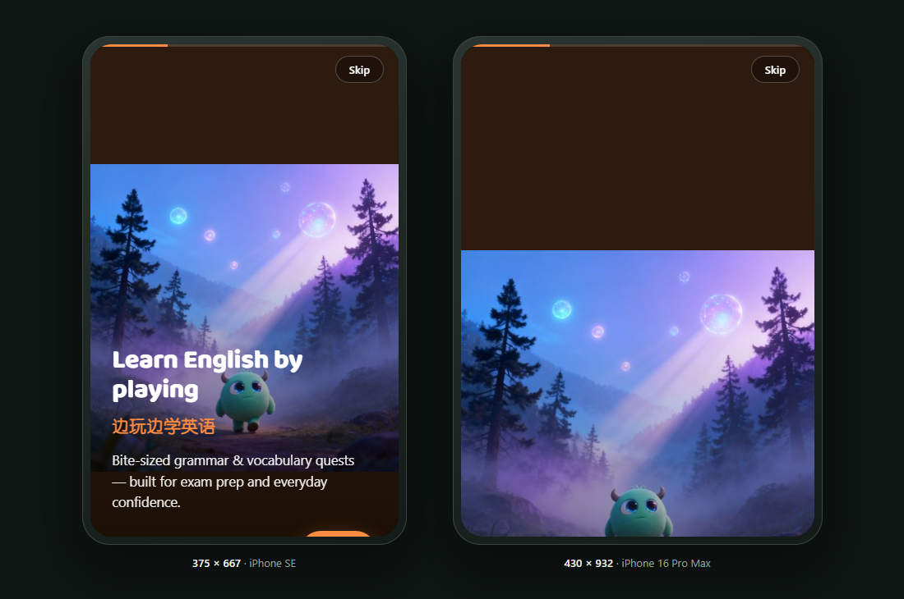

# responsive-audit

**A responsive layout audit that measures geometry instead of eyeballing screenshots.**



Point it at any URL. It loads the page at real device widths, traces the actual boxes, and tells you
*which element* breaks, *why*, and *which fix pattern* applies — then fails the build when the page would
break for a real user.

```bash
python scripts/responsive_audit.py --url https://example.com --devices iphone --out ./audit
```

```
    w  overflow  clip  <44px  <24px  tiny  zoom   img  verdict
  375         0     0     12      0     3     0     0  PASS
  390       238     0      9      0     3     0     0  FAIL overflow +238px
  430         0     0     11      0     3     0     1  FAIL 1 distorted img
```

## Why this exists

Every responsive bug is one of five things, and only one of them is a missing media query:

| Class | What you see | Fix |
|---|---|---|
| **Fixed dimension** | page scrolls sideways; one block sticks out | `max-width` + `%`, `minmax(min(240px,100%),1fr)` |
| **Rigid row** | columns squeezed or overflowing | `flex-wrap`, `auto-fit`, stack under 640px |
| **Clipped content** | text cut off by a fixed height | `min-height`, allow wrap, real disclosure |
| **Touch/type floor** | taps miss, iOS zooms on focus | pad the hit area, `font-size: max(16px, 1rem)` |
| **Viewport abuse** | content jumps with the URL bar, sits under the home indicator | `100svh`/`100dvh`, `env(safe-area-inset-*)` |

The principle behind all five:

> **Responsive layout is the absence of fixed constraints, not the presence of breakpoints.**
> Every dimension is intrinsic, relative, or bounded. Each hard width is a promise to break at some
> viewport — so the layout is built down from 320 CSS px, not down from a desktop screenshot.

## What it checks

Per width, on the real rendered page, after scrolling through lazy content and waiting for fonts:

- **Horizontal overflow** — `scrollWidth` vs the viewport, plus the elements crossing either edge,
  excluding anything inside a legitimate horizontal scroller.
- **A layout viewport that had to widen** to fit fixed-width content. Mobile emulation hides this from
  `window.innerWidth`, which is how audits report "no overflow" on a page that visibly scrolls sideways.
- **Text clipped** by a fixed height with `overflow: hidden`.
- **Tap targets** under 44 px and under 24 px (WCAG 2.5.8), with links inside a sentence exempted.
- **Inputs under 16 px** on phones — the iOS zoom-on-focus trap.
- **Squashed images** where width and height were set independently (`object-fit: fill`).
- **Type under 12 px**, and **fixed chrome** covering more than 35% of the screen — reported as advisory.
- **Viewport meta** missing `width=device-width`.

Hard failures fail the run (exit 1). Advisory findings are printed but do not. A passing script with an
ugly phone layout is still a fail — geometry is the floor, not the standard.

## Install

**As a Hermes / Claude Code skill** (it is a folder with a `SKILL.md`; both read that shape):

```bash
git clone https://github.com/lareesahu/responsive-audit.git \
  ~/.hermes/skills/design/responsive-audit        # Hermes
# or
git clone https://github.com/lareesahu/responsive-audit.git \
  ~/.claude/skills/responsive-audit               # Claude Code
```

**As a plain script** (no agent needed):

```bash
git clone https://github.com/lareesahu/responsive-audit.git
cd responsive-audit
pip install playwright && python -m playwright install chromium
python scripts/responsive_audit.py --url https://your-site.com
```

## Use

```bash
# the default ladder: 320 375 390 430 768 1024 1280 1440
python scripts/responsive_audit.py --url http://127.0.0.1:5173 --out ./audit

# real device heights, not just widths
python scripts/responsive_audit.py --url https://example.com --devices iphone
#   → 375x667 (SE), 390x844 (13), 430x932 (16 Pro Max)

# a two-phone comparison
python scripts/responsive_audit.py --url https://example.com --devices duo

# explicit sizes
python scripts/responsive_audit.py --url https://example.com --sizes 390x844,768x1024,1440x900

# no screenshots, custom report path
python scripts/responsive_audit.py --url https://example.com --no-shots --json report.json
```

Output: a table, one full-page screenshot per width, and `audit/report.json` with every finding —
selector, pixel geometry, and text excerpt, ready to diff between runs.

Exit codes: `0` all widths pass, `1` at least one hard failure. Drop it straight into CI.

## Demo

`examples/broken-page.html` is a page built to fail in all five ways. Audit it:

```bash
python scripts/responsive_audit.py --url "file://$PWD/examples/broken-page.html" --sizes 320x568,390x844
```

```
  320  +232  …  FAIL overflow +232px; 1 clipped; 1 input<16px; 1 distorted img
```

## What it does not do

- It does not choose your visual direction. Pair it with your design system; this tool audits mechanics.
- It does not prove Safari behaviour. Chromium emulation proves layout, not the dynamic toolbar, rubber-band
  scroll or keyboard insets. `references/ios-checklist.md` lists the 17 traps emulation cannot see — test
  those on a device, and say "unverified on iOS" when you have not.
- It does not replace judgment. It tells you where the layout breaks; deciding whether the phone should
  stack, scroll or show a compact variant is a design decision.

## Repository layout

```
SKILL.md                        the skill: principle, workflow, fix classes, pitfalls
references/device-ladder.md     widths and heights that matter, and why 320 is the floor
references/fix-patterns.md      exact CSS per failure class
references/ios-checklist.md     Safari/iOS behaviour emulation cannot test
scripts/responsive_audit.py     the detector (Playwright, one file, no dependencies beyond it)
examples/broken-page.html       a page that fails every check, for demos and regression
```

## License

MIT. Use it, fork it, ship it inside your own tooling.

Built by [Lareesa Hu](https://github.com/lareesahu) — Pulse Branding. Extracted from real audits of
production sites, not from a checklist.
