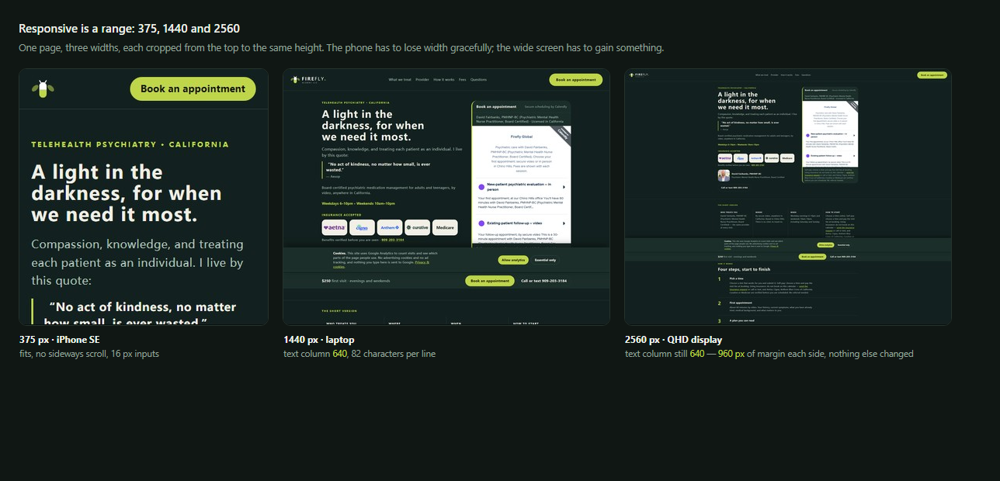

# responsive-audit

**A responsive layout audit that measures geometry instead of eyeballing screenshots — from the 320 px
reflow floor to a 3440 px ultrawide.**




Point it at any URL. It loads the page at every width that matters, traces the actual boxes, and tells you
*which element* breaks, *why*, and *which fix pattern* applies — at both ends of the range, because a page
that is perfect on a phone can still be a narrow ribbon on a 27-inch display.

```bash
python scripts/responsive_audit.py --url https://example.com --devices full --out ./audit
```

```
    w  overflow  clip  <44px  <24px  tiny  zoom   img  long  up  verdict
  375         0     0     12      0     3     0     0    62   0  PASS
  390       238     0      9      0     3     0     0    62   0  FAIL overflow +238px
 1440         0     0      9      0     8     0     0    82   0  PASS
 2560         0     0      9      0     8     0     0   118   1  FAIL 118 chars/line; image upscaled 1.6x
```

## Why this exists

Responsiveness fails in two directions, and most audits only check one.

| Narrow end (320–430) | Wide end (1440–3840) |
|---|---|
| fixed widths force a sideways scroll | a 1200 px column floats in 1300 px of margin |
| rigid rows overflow | lines run 120+ characters |
| text clipped by a fixed height | a 900 px photo stretched to 2400 px, blurry |
| taps miss, iOS zooms on focus | three cards, each 700 px of empty air |
| content jumps with the URL bar | hamburger nav on a 27-inch display |

Every one of those is a missing constraint, not a missing media query:

> **Responsive layout is the absence of fixed constraints, not the presence of breakpoints.**
> Every dimension is intrinsic (content decides), relative (`%`, `fr`, `vw` inside `clamp()`), or bounded
> (`min()` / `max()`). Each hard width is a promise to break at some viewport. So the layout is built down
> from 320 CSS px and up from 1440 — never from a single desktop screenshot.

## Standards it encodes

| Source | Rule |
|---|---|
| [WCAG 2.2 SC 1.4.10 Reflow](https://www.w3.org/WAI/WCAG22/Understanding/reflow.html) | No 2-D scrolling at 320 CSS px / 400% zoom |
| [WCAG 2.2 SC 1.4.8 Visual Presentation](https://www.w3.org/WAI/WCAG22/Understanding/visual-presentation.html) | Lines ≤ 80 characters, ≤ 40 for CJK |
| [WCAG 2.2 SC 2.5.8 Target Size](https://www.w3.org/WAI/WCAG22/Understanding/target-size-minimum.html) | Targets ≥ 24 × 24 px |
| [Apple HIG — Layout](https://developer.apple.com/design/human-interface-guidelines/layout) | Adapt to size classes and window configurations; guides "restrict the width of text for optimal readability"; preview the **largest and smallest** layouts |
| [Apple `readableContentGuide`](https://developer.apple.com/documentation/uikit/uiview/readablecontentguide) | Readable width is a first-class constraint |
| [Android / Material window size classes](https://developer.android.com/develop/ui/compose/layouts/adaptive/use-window-size-classes) | compact < 600 · medium 600–839 · expanded 840–1199 · large 1200–1599 · extra-large ≥ 1600 |
| [MDN — viewport units](https://developer.mozilla.org/en-US/docs/Web/CSS/length) | `svh`/`dvh`/`lvh` exist because `vh` lies on mobile |

## What it checks

On the real rendered page, after scrolling through lazy content and waiting for fonts:

**Narrow end**
- **Horizontal overflow** — `scrollWidth` vs the viewport, plus the elements crossing either edge,
  excluding anything inside a legitimate horizontal scroller.
- **A layout viewport that had to widen** to fit fixed-width content. Mobile emulation hides this from
  `window.innerWidth`, which is how audits report "no overflow" on a page that visibly scrolls sideways.
- **Text clipped** by a fixed height with `overflow: hidden`.
- **Tap targets** under 44 px and under 24 px, with links inside a sentence exempted.
- **Inputs under 16 px** on phones — the iOS zoom-on-focus trap.
- **Squashed images** where width and height were set independently.

**Wide end**
- **Characters per line**, measured from real line boxes: over 80 (or 40 for CJK) is reported, 25% over
  fails. This is the failure no box measurement catches.
- **Upscaled images** — rendered width × device pixel ratio against the file's own pixels.
- **Content utilisation** at 1600 px and above, plus a "layout plateaus" note when the page is identical at
  1440 and 2560, with how many px are dead on each side.
- **Type, chrome and targets** at wide widths, where the same 12 px eyebrow is now unreadable.

Hard failures fail the run (exit 1); advisory findings are printed but do not. A passing script with an ugly
phone layout, or a tidy phone page that turns into a narrow ribbon on an ultrawide, is still a fail —
geometry is the floor, not the standard.

## Install

**As a Hermes / Claude Code skill** (it is a folder with a `SKILL.md`; both read that shape):

```bash
git clone https://github.com/lareesahu/responsive-audit.git \
  ~/.hermes/skills/design/responsive-audit        # Hermes
# or
git clone https://github.com/lareesahu/responsive-audit.git \
  ~/.claude/skills/responsive-audit               # Claude Code
```

**As a plain script** (no agent needed):

```bash
git clone https://github.com/lareesahu/responsive-audit.git
cd responsive-audit
pip install playwright && python -m playwright install chromium
python scripts/responsive_audit.py --url https://your-site.com
```

## Use

```bash
# default ladder: 320 375 390 430 768 1024 1440 1920 2560
python scripts/responsive_audit.py --url http://127.0.0.1:5173 --out ./audit

# presets
python scripts/responsive_audit.py --url https://example.com --devices iphone   # 375x667, 390x844, 430x932
python scripts/responsive_audit.py --url https://example.com --devices wide     # 1440 -> 3440
python scripts/responsive_audit.py --url https://example.com --devices full     # 320 -> 2560, all of it
python scripts/responsive_audit.py --url https://example.com --devices duo      # two phones, side by side

# explicit sizes, or no screenshots with a custom report path
python scripts/responsive_audit.py --url https://example.com --sizes 390x844,768x1024,2560x1440
python scripts/responsive_audit.py --url https://example.com --no-shots --json report.json
```

Output: a table, one full-page screenshot per width, and `audit/report.json` with every finding — selector,
pixel geometry, characters per line, dead margins and text excerpt, ready to diff between runs.

Exit codes: `0` all widths pass, `1` at least one hard failure. Drop it straight into CI.

## Demo

`examples/broken-page.html` fails on purpose: a fixed 520 px block, a rigid two-column row, text clipped by a
40 px box, a 12 px input, a squashed image and an 18 px button.

```bash
python scripts/responsive_audit.py --url "file://$PWD/examples/broken-page.html" --sizes 320x568,390x844
```

## What it does not do

- It does not choose your visual direction. Pair it with your design system; this tool audits mechanics.
- It does not prove Safari behaviour, or how a page feels on a real 32-inch monitor. Chromium emulation proves
  layout after a resize. `references/ios-checklist.md` lists the 17 traps emulation cannot see — test those
  on a device, and say "unverified" when you have not.
- It does not replace judgment. It tells you where the layout breaks; deciding whether a wide page should add
  columns, widen the measure or compose deliberately is a design decision.

## Repository layout

```
SKILL.md                        the skill: principle, both ends, workflow, standards, pitfalls
references/device-ladder.md     every width from 320 to 3840, window size classes, wide thresholds
references/fix-patterns.md      exact CSS per failure class, narrow and wide
references/ios-checklist.md     Safari/iOS behaviour emulation cannot test
scripts/responsive_audit.py     the detector (Playwright, one file, no dependencies beyond it)
examples/broken-page.html       a page that fails every check, for demos and regression
```

## License

MIT. Use it, fork it, ship it inside your own tooling.

Built by [Lareesa Hu](https://github.com/lareesahu) — Pulse Branding. Extracted from real audits of
production sites, not from a checklist.
